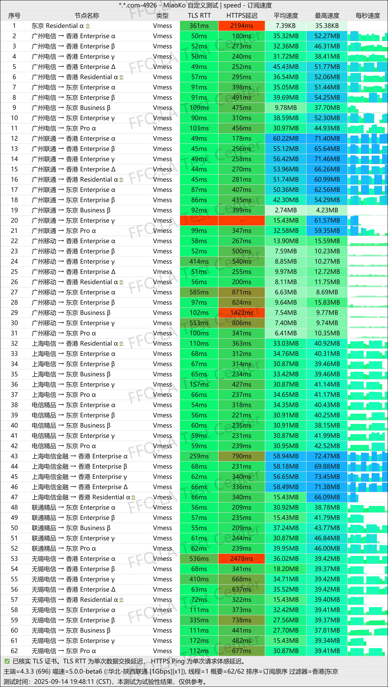
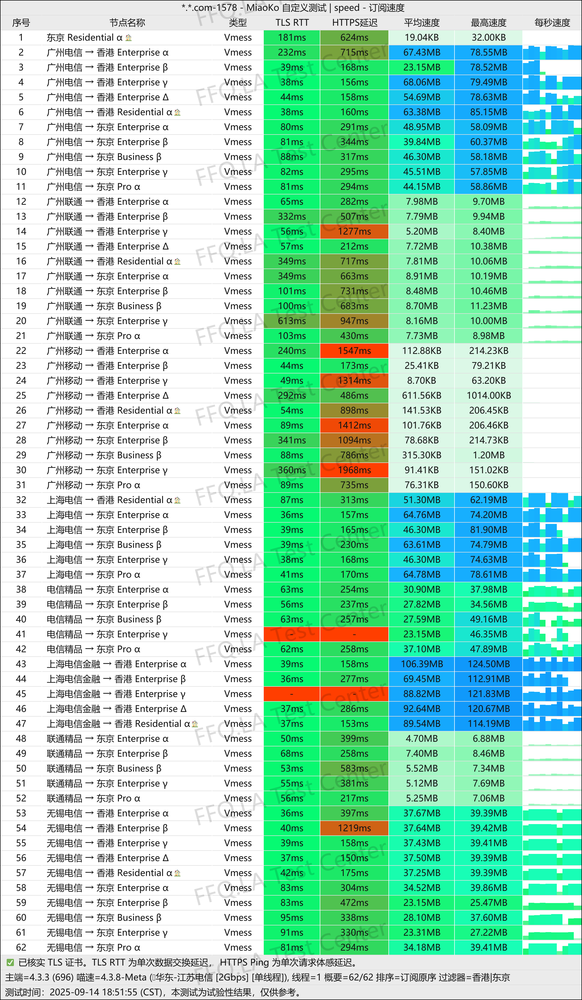
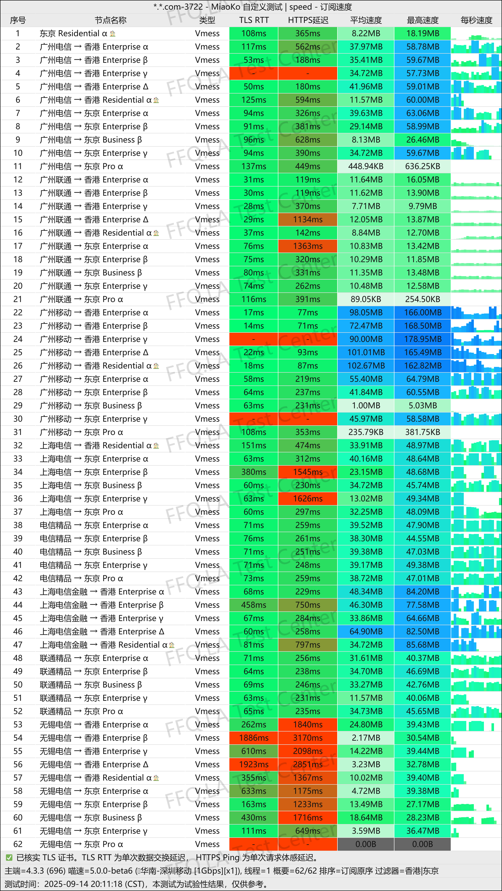
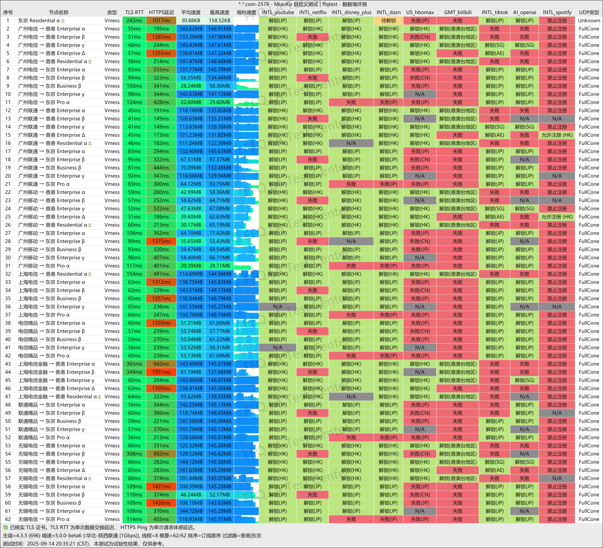
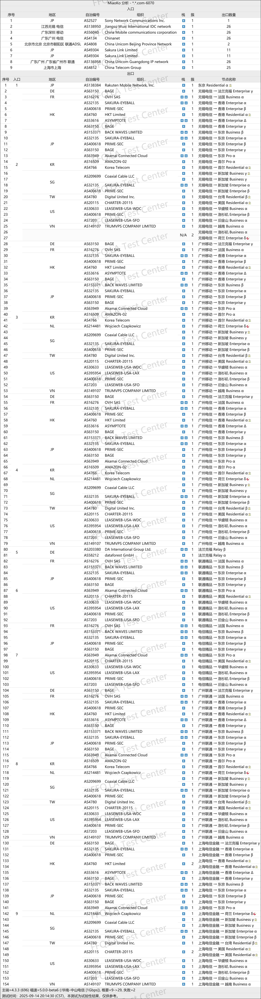

🇨🇳 [中文](README.md) | 🇺🇸 English | 🇷🇺 [Русский](README_RU.md) | 🇮🇷 [فارسی](README_FA.md)

# V2PAW VPN Official Website (Updated November 3, 2026)

Official V2PAW VPN Website 
Latest URL: [dash.v2paw.com](https://to.iix.im/v201) 
Official URL: [dash.v2paw.com](https://to.iix.im/v201) 

Best VPN Recommendations and Server List for 2026: [https://github.com/jdnei/JiChangTuiJian](https://github.com/jdnei/JiChangTuiJian) 

## Telegram VPN Deals & Community #AD
[VPN Giveaways](https://331024.de/archives/choujiang) | [VPN Chat Group](https://331024.de/archives/choujiang) | [VPN Trial Group](https://331024.de/archives/choujiang) 

[https://331024.de/archives/choujiang](https://331024.de/archives/choujiang)

## Overview
V2PAW VPN, also known as Cat Paw VPN, is a network service provider focused on delivering stable and high-speed internet connections.

The service uses the VMess protocol and offers a wide selection of relay and direct-connection servers across multiple popular countries and regions.

## Advantages
V2PAW VPN provides servers in popular locations, including Hong Kong, Japan, Taiwan, Singapore, and the United States.

Its network primarily uses relay connections while also offering selected direct-connection servers.

With a wide selection of network routes and exit servers, V2PAW provides flexible monthly data allowances for individual users and dedicated subscription options for teams.

The service supports various activities, including everyday web browsing, HD video streaming, and international remote work.

V2PAW is particularly suitable for users who prioritize server availability, diverse routing options, and flexible subscription plans.

## Pricing Plans

| Plan | Monthly Data | Available Servers | Annual Price | Monthly Price |
| --- | ---: | ---: | ---: | ---: |
| Personal Plan - Basic | 100 GiB | 46 | ¥288.00/year | ¥30.00/month |
| Personal Plan - Standard | 200 GiB | 48 | ¥480.00/year | ¥50.00/month |
| Personal Plan - Premium | 500 GiB | 48 | ¥960.00/year | ¥100.00/month |
| Personal Plan - Deluxe | 1.25 TiB | 48 | ¥1,920.00/year | ¥200.00/month |
| Team Plan - Starter | 10 TiB | 54 | ¥12,000.00/year | ¥1,000.00/month |

## 📊 Performance Tests & Analysis

#### 1.1 China Unicom Evening Peak-Hour Speed Test
 

#### 1.2 China Telecom Evening Peak-Hour Speed Test
 

#### 1.3 China Mobile Evening Peak-Hour Speed Test
 

#### 2. Streaming Service Unblocking Report
 

#### 3. Entry and Exit Node Analysis
 
