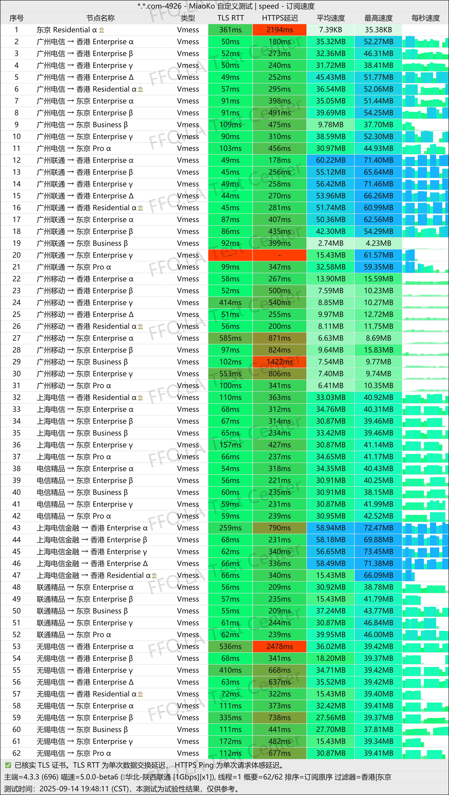
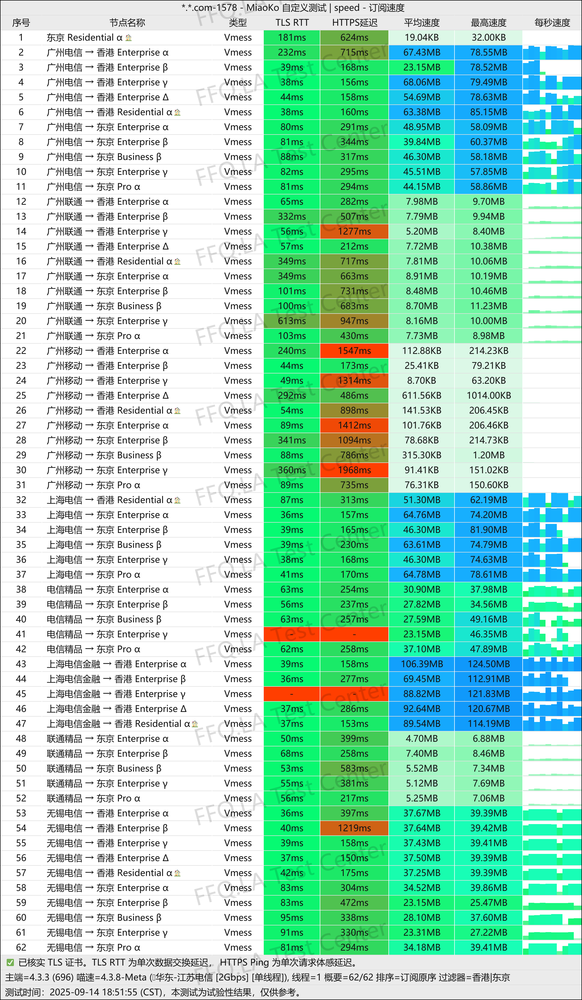
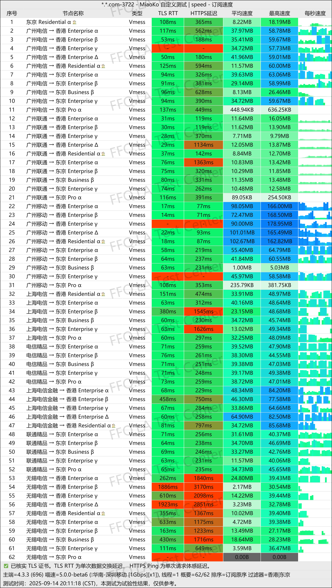
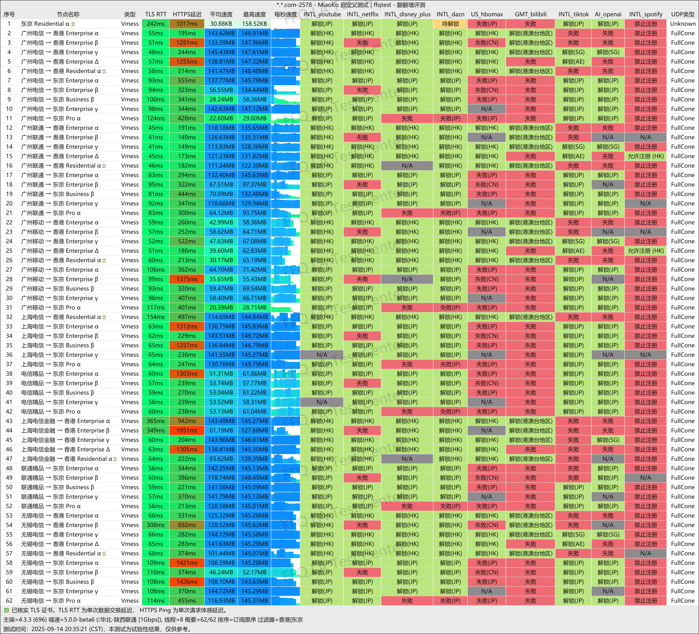
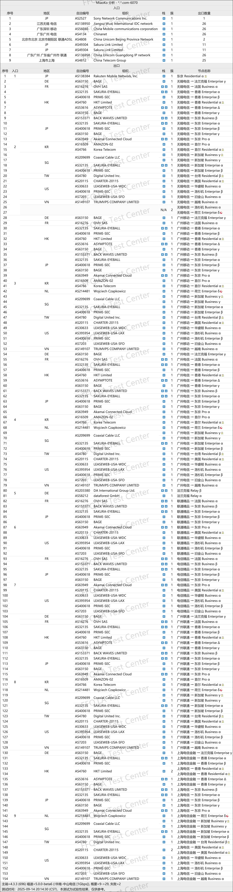

 🇨🇳 [中文](README.md) | 🇺🇸 [English](README_EN.md) | 🇷🇺 [Русский](README_RU.md) | 🇮🇷 فارسی

# وب‌سایت رسمی V2PAW VPN(به‌روزرسانی 11 نوامبر 2026)
وب‌سایت رسمی V2PAW VPN 
آخرین آدرس: [dash.v2paw.com](https://to.iix.im/v201) 
آدرس رسمی: [dash.v2paw.com](https://to.iix.im/v201) 

معرفی بهترین سرویس‌ها و سرورهای VPN در سال ۲۰۲۶: [https://github.com/jdnei/JiChangTuiJian](https://github.com/jdnei/JiChangTuiJian) 

## انجمن و پیشنهادهای ویژه VPN در تلگرام #AD
[قرعه‌کشی VPN](https://331024.de/archives/choujiang) | [گروه گفت‌وگوی VPN](https://331024.de/archives/choujiang) | [گروه آزمایش VPN](https://331024.de/archives/choujiang) 

[https://331024.de/archives/choujiang](https://331024.de/archives/choujiang)

## معرفی
V2PAW VPN که با نام Cat Paw VPN نیز شناخته می‌شود، یک ارائه‌دهنده خدمات شبکه است که بر ارائه اتصال اینترنت پایدار و پرسرعت تمرکز دارد.

این سرویس از پروتکل VMess استفاده می‌کند و مجموعه گسترده‌ای از سرورهای رله و اتصال مستقیم را در کشورهای مختلف و مناطق محبوب ارائه می‌دهد.

## مزایا
V2PAW VPN سرورهایی در مکان‌های پرطرفدار مانند هنگ‌کنگ، ژاپن، تایوان، سنگاپور و ایالات متحده آمریکا ارائه می‌کند.

شبکه این سرویس عمدتاً از اتصالات رله استفاده می‌کند، اما تعدادی سرور با اتصال مستقیم نیز در دسترس هستند.

با تنوع بالای مسیرهای شبکه و سرورهای خروجی، V2PAW حجم‌های مختلف ترافیک ماهانه را برای کاربران شخصی و طرح‌های اشتراک اختصاصی را برای تیم‌ها فراهم می‌کند.

این سرویس از فعالیت‌های مختلفی مانند مرور روزمره وب، تماشای ویدئوهای باکیفیت و دورکاری بین‌المللی پشتیبانی می‌کند.

V2PAW به‌ویژه برای کاربرانی مناسب است که تعداد سرورهای در دسترس، تنوع مسیرهای ارتباطی و انعطاف‌پذیری طرح‌های اشتراک را در اولویت قرار می‌دهند.

## طرح‌های اشتراک

| طرح | حجم ماهانه | تعداد سرورهای در دسترس | قیمت سالانه | قیمت ماهانه |
| --- | ---: | ---: | ---: | ---: |
| طرح شخصی - پایه | 100 GiB | 46 | ¥288.00/سال | ¥30.00/ماه |
| طرح شخصی - استاندارد | 200 GiB | 48 | ¥480.00/سال | ¥50.00/ماه |
| طرح شخصی - پیشرفته | 500 GiB | 48 | ¥960.00/سال | ¥100.00/ماه |
| طرح شخصی - لوکس | 1.25 TiB | 48 | ¥1,920.00/سال | ¥200.00/ماه |
| طرح تیمی - مقدماتی | 10 TiB | 54 | ¥12,000.00/سال | ¥1,000.00/ماه |

## 📊 آزمایش عملکرد و تحلیل

#### 1.1 آزمایش سرعت China Unicom در ساعات اوج مصرف شبانه
 

#### 1.2 آزمایش سرعت China Telecom در ساعات اوج مصرف شبانه
 

#### 1.3 آزمایش سرعت China Mobile در ساعات اوج مصرف شبانه
 

#### 2. گزارش رفع محدودیت سرویس‌های پخش آنلاین
 

#### 3. تحلیل سرورهای ورودی و خروجی
 
