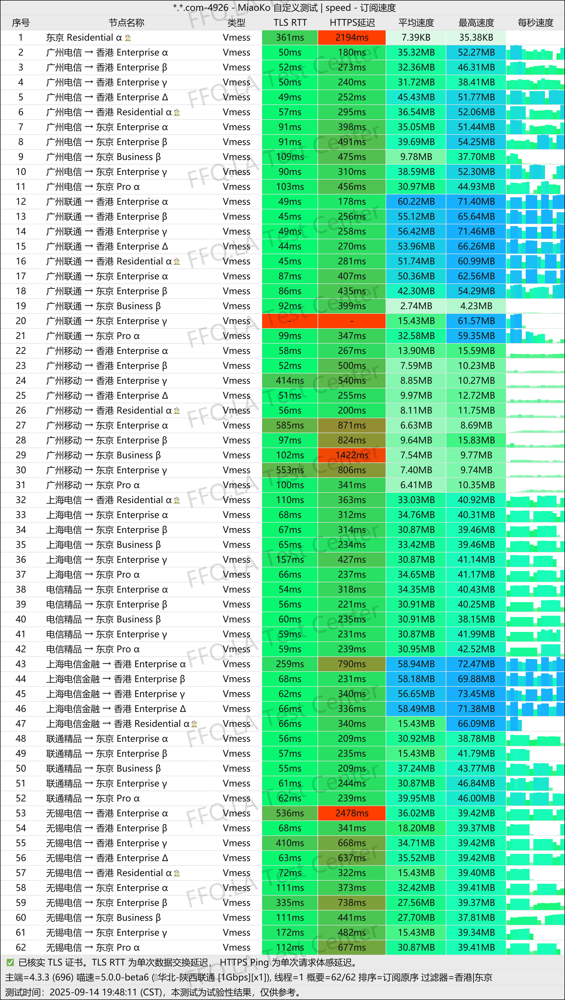
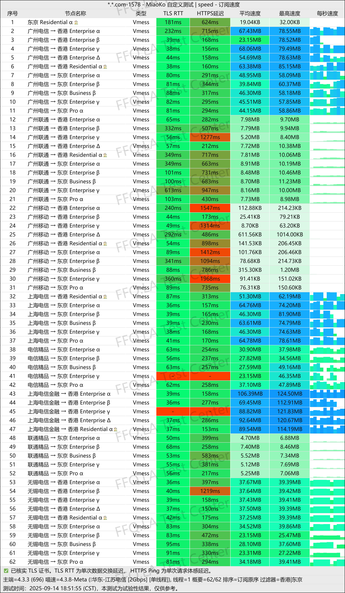
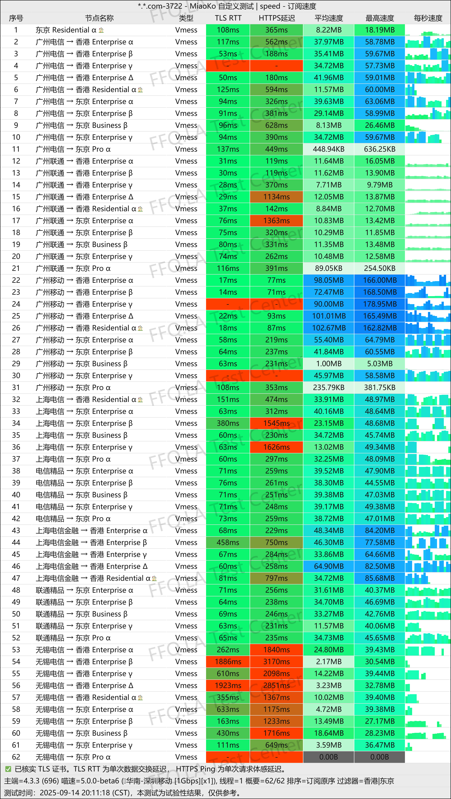
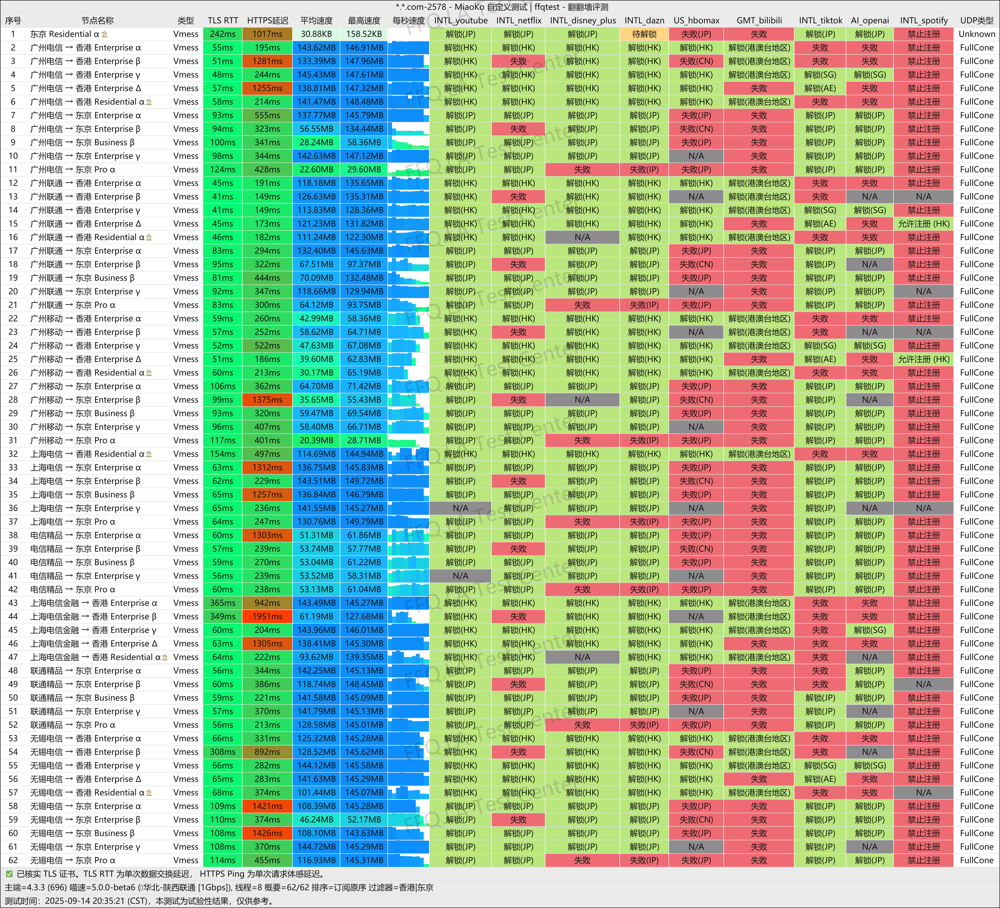
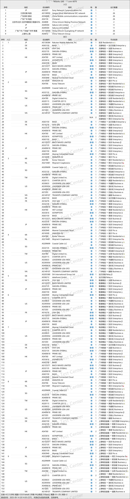

🇨🇳 [中文](README.md) | 🇺🇸 [English](README_EN.md) | 🇷🇺 Русский | 🇮🇷 [فارسی](README_FA.md)

# Официальный сайт V2PAW VPN (обновлено 7 ноября 2026)

Официальный сайт V2PAW VPN 
Актуальный адрес: [dash.v2paw.com](https://to.iix.im/v201) 
Официальный адрес: [dash.v2paw.com](https://to.iix.im/v201) 

Лучшие VPN-сервисы и серверы на 2026 год: [https://github.com/jdnei/JiChangTuiJian](https://github.com/jdnei/JiChangTuiJian) 

## Telegram: VPN-сообщество и специальные предложения #AD
[Розыгрыши VPN](https://331024.de/archives/choujiang) | [Чат о VPN](https://331024.de/archives/choujiang) | [Группа тестирования VPN](https://331024.de/archives/choujiang) 

[https://331024.de/archives/choujiang](https://331024.de/archives/choujiang)

## Обзор
V2PAW VPN, также известный как Cat Paw VPN, — провайдер сетевых услуг, ориентированный на стабильное и высокоскоростное интернет-соединение.

Сервис использует протокол VMess и предлагает широкий выбор ретрансляционных серверов и серверов с прямым подключением в различных популярных странах и регионах.

## Преимущества
V2PAW VPN предоставляет серверы в популярных регионах, включая Гонконг, Японию, Тайвань, Сингапур и США.

Сетевая инфраструктура преимущественно использует ретрансляционные соединения, однако также доступны отдельные серверы с прямым подключением.

Благодаря широкому выбору сетевых маршрутов и выходных серверов V2PAW предлагает гибкие месячные лимиты трафика для частных пользователей и специальные тарифные планы для команд.

Сервис подходит для различных задач, включая повседневный просмотр веб-сайтов, потоковое видео высокого разрешения и международную удалённую работу.

V2PAW особенно подходит пользователям, которые ценят большое количество доступных серверов, разнообразие маршрутов и гибкость тарифных планов.

## Тарифные планы

| Тариф | Трафик в месяц | Доступные серверы | Годовая цена | Месячная цена |
| --- | ---: | ---: | ---: | ---: |
| Персональный тариф - Базовый | 100 GiB | 46 | ¥288.00/год | ¥30.00/мес. |
| Персональный тариф - Стандартный | 200 GiB | 48 | ¥480.00/год | ¥50.00/мес. |
| Персональный тариф - Премиум | 500 GiB | 48 | ¥960.00/год | ¥100.00/мес. |
| Персональный тариф - Люкс | 1.25 TiB | 48 | ¥1,920.00/год | ¥200.00/мес. |
| Командный тариф - Начальный | 10 TiB | 54 | ¥12,000.00/год | ¥1,000.00/мес. |

## 📊 Тесты производительности и анализ

#### 1.1 Тест скорости China Unicom в вечерние часы пик
 

#### 1.2 Тест скорости China Telecom в вечерние часы пик
 

#### 1.3 Тест скорости China Mobile в вечерние часы пик
 

#### 2. Отчёт о разблокировке стриминговых сервисов
 

#### 3. Анализ входных и выходных узлов
 
